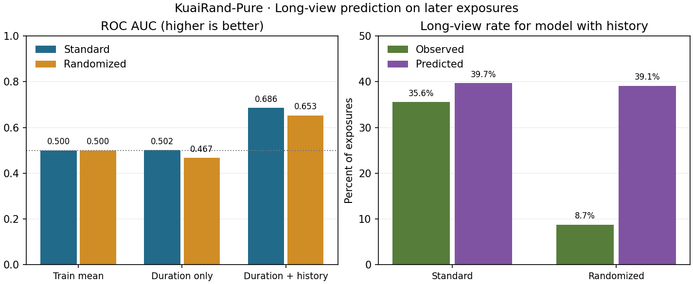

# 短视频推荐小样：换一种曝光方式，模型还能预测长观看吗？

用 KuaiRand-Pure 的常规曝光记录训练一个概率模型，分别在后续同一时段的常规曝光和随机曝光上验证。比较训练集均值、只看视频时长的逻辑回归，以及同时使用用户与视频历史的逻辑回归。

## 复现

需要 Python 3.9+、NumPy、pandas 和 Matplotlib。脚本直接读取归档，不需要解压和补充数据。

```bash
python3 -m pip install numpy pandas matplotlib
mkdir -p data
curl --fail --location --retry 3 --output data/KuaiRand-Pure.tar.gz \
  https://zenodo.org/records/10439422/files/KuaiRand-Pure.tar.gz
python3 run_pilot.py
```

数据归档约 47.4 MB，归档内的 `LICENSE` 为 CC BY-SA 4.0，脚本会核对数据作者公布的 MD5。可从 [KuaiRand 项目页](https://kuairand.com/) 进入国内下载镜像，也可以从 [Zenodo 发布页](https://zenodo.org/records/10439422) 直接下载。数据来源为 Gao 等人的 [KuaiRand 论文](https://doi.org/10.1145/3511808.3557624)。

## 实验设计

只保留 `tab=1` 同一曝光场景与正时长的视频记录。目标字段 `long_view` 表示用户看完了短于 18 秒的视频，或观看较长视频至少 18 秒。视频时长在曝光时已经可知，而且参与标签定义，因此单独比较时长基线。历史特征采用四项统计量：用户与视频的曝光次数、用户与视频的平滑长观看率。历史不足时使用更靠近全局均值的估计，完全缺失时采用全局均值。

| 数据用途 | 记录来源 |
| --- | --- |
| 计算并冻结历史特征 | 2022-04-14 之前的常规曝光 |
| 拟合概率模型与均值基线 | 2022-04-14 至 2022-04-21 的常规曝光 |
| 测试 | 2022-04-22 至 2022-05-08 两组均有记录的日期，常规和随机曝光分别打分 |

两个测试组使用同一套冻结的历史特征、模型系数和指标。随机曝光来自平台实际的随机替换，测试样本仍局限于该时间段、场景和候选视频池。两组曝光所面对的视频和用户分布可以不同，分数差值衡量模型在这两组日志上的表现。这个实验预测一次曝光后的反馈，策略的累计回报需要在可交互环境中另行评估。

`results/metrics.csv` 记录正例比例、平均预测、ROC AUC 和 Log loss，`results/run.json` 保存实际日期和回归系数，`results/comparison.png` 展示同一模型在两组测试中的表现。

## 实测结果

历史特征使用 580,854 条记录，模型使用 235,984 条记录拟合。常规测试有 219,927 条记录，随机测试有 1,141,393 条。两组测试都覆盖 2022-04-22 至 2022-05-08 的 17 天。本机 CPU 读取归档、拟合、打分和出图共约 1.5 秒。

| 模型 | 常规 ROC AUC ↑ | 随机 ROC AUC ↑ | 常规 Log loss ↓ | 随机 Log loss ↓ |
| --- | ---: | ---: | ---: | ---: |
| 训练集均值 | 0.5000 | 0.5000 | 0.6544 | 0.5408 |
| 只看时长 | 0.5017 | 0.4669 | 0.6544 | 0.5409 |
| 时长与历史 | 0.6858 | 0.6531 | 0.6049 | 0.5374 |

加入历史后，两组都更能把长观看排在前面。但随机曝光的实际长观看率只有 8.74%，模型平均给出 39.12% 的概率。常规曝光的实际值和预测值分别是 35.59% 与 39.70%。这提供了一个可继续追问的现象：模型换了曝光方式后还保留一定排序能力，概率估计却明显偏高。比较 Log loss 时，应把每组的模型与同组基线对照，因为两组的正例比例不同。


