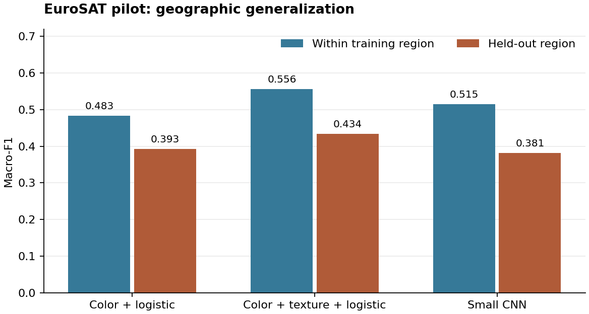

# 卫星图像分类与地理泛化

只用颜色分布能区分多少种地表类型？加入边缘和纹理以后，到了训练时未见的区域，提升还在吗？

在此目录运行 `python3 run.py`。需要 Python、NumPy、Pillow 和 PyTorch，脚本使用 CPU。可用 `--epochs 2` 快速检查流程，默认训练 12 轮。`--output-dir` 可把结果写到另一目录。

数据放在 `data/`。原始 RGB 文件是作者发布的 `EuroSAT_RGB.zip`，大小约 94.7 MB，MD5 为 `f46e308c4d50d4bf32fedad2d3d62f3b`。三个 `eurosat-spatial-{train,val,test}.txt` 来自 TorchGeo 的经度划分，固定到 `68508ce`。EuroSAT 发布方使用 MIT 许可，并请使用者查阅 Copernicus Sentinel 数据条款。 [原始数据与校验值](https://zenodo.org/records/7711810) · [数据许可](https://github.com/phelber/EuroSAT#license) · [TorchGeo 划分](https://huggingface.co/datasets/torchgeo/eurosat/tree/68508ce)

需要重新下载时，可在此目录运行以下命令。

```bash
mkdir -p data
curl -fL -C - -o data/EuroSAT_RGB.zip 'https://zenodo.org/records/7711810/files/EuroSAT_RGB.zip'
for split in train val test; do
  curl -fL -o "data/eurosat-spatial-$split.txt" "https://huggingface.co/datasets/torchgeo/eurosat/resolve/68508ce/eurosat-spatial-$split.txt"
done
```

| 小样划分     | 来源                                | 图片数 |
| ------------ | ----------------------------------- | -----: |
| 训练         | TorchGeo 训练区域                   |  2,000 |
| 验证         | TorchGeo 验证区域                   |    400 |
| 区域内测试   | TorchGeo 训练区域，图片与训练集分开 |    500 |
| 留出区域测试 | TorchGeo 测试区域                   |    500 |

四个集合都按十类等量采样，固定随机种子。图像缩放至 32×32，三个模型使用相同的图片。比较只用颜色直方图的逻辑回归、加入局部梯度方向直方图的逻辑回归，以及小型 CNN。两个逻辑回归的特征标准化均只使用训练集统计量。CNN 按验证集损失选取训练轮次。

实测使用两个 CPU 线程，读取本地数据、训练和评估共用时 5.5 秒。CNN 在第 11 轮达到最低验证损失。

| 模型                  | 区域内准确率 / Macro-F1 | 留出区域准确率 / Macro-F1 |
| --------------------- | ----------------------: | ------------------------: |
| 颜色直方图 + 逻辑回归 |           0.512 / 0.483 |             0.414 / 0.393 |
| 颜色与纹理 + 逻辑回归 |           0.556 / 0.556 |             0.446 / 0.434 |
| 小型 CNN              |           0.540 / 0.515 |             0.412 / 0.381 |

在这次小样中，加入纹理的逻辑回归在两套测试图像上都有提升，三个模型在留出区域的分数都下降。可进一步查阅混淆矩阵，看看下降主要发生在哪些地表类别。这个结果依赖固定抽样、图像分辨率和模型训练配置。

`pilot_splits.csv` 记录具体图片，`predictions.csv` 包含每张验证和测试图片的预测，`results.json` 包含准确率、Macro-F1、逐类 F1、混淆矩阵和耗时。混淆矩阵按实际类别排在行、预测类别排在列。两个测试集的图像来自不同区域，报告结论应限定在这两个留出样本和一次固定划分上。



安装 Matplotlib 后，运行 `python3 plot.py` 可根据 `results.json` 重新生成对照图。
